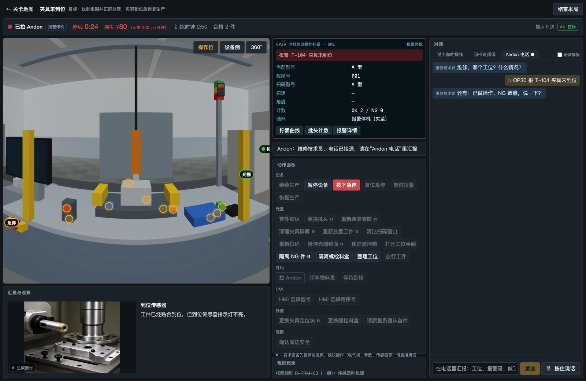
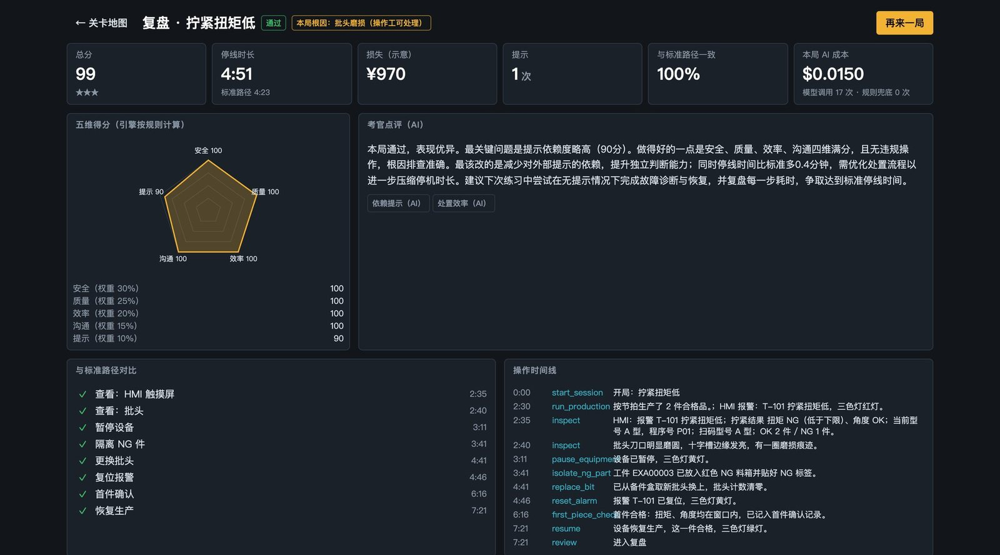
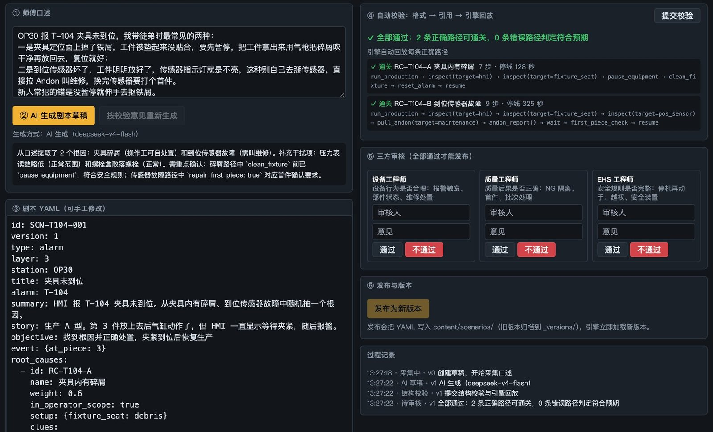

# 产线排障情景训练系统

帮工厂新入职的操作工，在不碰真设备、不停线的情况下，反复练习处理产线故障。



## 这个项目是干什么的

新人上岗后遇到设备报警，往往只能停下来等师傅。师傅要同时照顾好几个工位，不一定顾得上。同一个故障可能隔很久才再出现一次，这次学会了，下次又忘了。产线也不能停下来让新人拿真设备练手。

这个系统把工位搬进浏览器。新人在工位全景里找线索、查看部件、判断原因、动手处理，处理不了就拉 Andon 打电话叫维修，每一步都有后果。一局结束后有复盘：得了多少分、哪一步做错了、和标准做法差在哪。

同一个报警，每局的原因是随机抽的。比如“拧紧扭矩低”，可能是批头磨损、螺栓混料，也可能是换型后程序号没切换，处理方法各不相同。背步骤没有用，只能真的去排查。

适合工厂的培训负责人和带班班长了解这种培训方式，也适合想做类似产品的开发者参考或改造。

> **请注意**：系统自带的是一个虚构的示例工位（转向系统总成装配车间的 OP30 电机总成螺栓拧紧工位）。所有设备、报警码、规则和参数都是虚构的，只用于演示，不能当作真实设备的操作规程。

## 有什么功能

| 入口 | 给谁用 | 能做什么 |
| --- | --- | --- |
| **训练端** | 新员工 | 在全景工位里排查故障，用按钮或口语操作；可以问带班师傅要提示，打 Andon 电话汇报；结束后看复盘和段位 |
| **关卡工坊** | 老师傅、工程师 | 师傅口述一个故障，AI 起草关卡，系统自动校验并回放每条正确路径，设备、质量、安全三方审核后发布 |
| **管理看板** | 培训负责人 | 看学员进度、关卡完成率、处置时长、提示使用率、安全违规和错误分布（自带的是演示数据） |
| **评测台** | 开发者 | 用 200 条测试用例比较不同模型的安全性、准确率、速度和成本，并记录出错的例子 |

自带内容：14 个关卡、10 种报警、26 种根因、36 条规则。

**AI 和规则怎么分工**：设备怎么反应、算不算违规、得多少分、维修几分钟到场，全部由规则引擎计算，结果可以复现。大模型只负责听懂口语、扮演师傅和维修人员、给提示、写复盘点评、起草关卡。所以模型说错话也改不了事实，没有 API Key 或者断网时也能继续训练。

| 复盘 | 关卡工坊 |
| --- | --- |
|  |  |

## 下载和启动

**需要准备**：[Python 3.13](https://www.python.org/downloads/) 和一个常用浏览器（推荐 Chrome）。不需要安装 Node、数据库或 Docker。

**第一步：下载代码**

```bash
git clone https://github.com/ZeroOnehub/production-line-troubleshooting-training.git
cd production-line-troubleshooting-training
```

不用 Git 的话，点本页右上方绿色的 **Code → Download ZIP**，下载后解压。

**第二步：启动**

**Mac**：双击 `启动训练系统.command`。第一次会自动安装运行环境并准备数据（需要联网，约 1–2 分钟），然后浏览器自动打开系统。关闭弹出的窗口就是停止系统。

如果 Mac 提示无法打开或无法验证开发者：打开“系统设置 → 隐私与安全性”，在页面下方点“仍要打开”。还是打不开的话，用下面的命令启动，在 Mac 上同样适用。

**Windows / Linux**：打开命令行，进入项目文件夹，运行：

```bash
python3 -m venv .venv
source .venv/bin/activate        # Windows 改成 .venv\Scripts\activate，并把上一行的 python3 改成 python
pip install -r backend/requirements.txt
python scripts/seed.py           # 只有第一次需要
python -m uvicorn app.api.main:app --app-dir backend --port 8000
```

然后用浏览器打开 <http://localhost:8000>。

> 这个项目是在 Mac 和 Python 3.13 上测试的，Windows 和 Linux 还没有实际测试过。

到这一步，不填 API Key 也能完整地打关卡，只是 AI 角色换成了规则版本，页面右上角显示“降级·规则”。这时候系统只听得懂比较标准的说法（比如“看看批头”），提示和点评也是固定的话术。想要 AI 陪练，继续看下一节。

## 接入你自己的 API Key

系统默认通过 [AIHubMix](https://aihubmix.com) 调用模型，这个平台用一个 Key 就能调用多家模型。

1. 到 AIHubMix 注册账号，创建一个 API Key，并给账户充值。
2. 在项目文件夹里，把 `.env.example` 复制一份，改名为 `.env`。

   ```bash
   cp .env.example .env             # Windows 用 copy .env.example .env
   ```

   Mac 的访达默认不显示点开头的文件，按 `Cmd + Shift + .` 就能看到。

3. 用文本编辑器打开 `.env`，把 Key 填在等号后面，保存：

   ```
   AIHUBMIX_API_KEY=你的Key
   ```

4. 关掉系统，重新启动。
5. 看页面右上角：显示绿色的“在线”就接好了。也可以运行下面的命令检查，看“模型 API 连通性”这一项：

   ```bash
   .venv/bin/python scripts/check.py   # Windows 用 .venv\Scripts\python scripts\check.py
   ```

Key 只保存在你电脑上的 `.env` 文件里，这个文件已被 Git 忽略。不要把它发给别人，也不要写进代码。

**费用**：用默认模型时，一局训练的模型费用大约 1–2 美分，以平台的实际价格为准。

**想换成别的平台**：任何兼容 OpenAI 接口的服务都可以。打开 `config/models.yaml`，加上你的平台并设为默认：

```yaml
provider:
  default: myplatform
  platforms:
    myplatform:
      base_url: https://你的平台地址/v1
      api_key_env: MY_API_KEY
```

然后在 `.env` 里加一行 `MY_API_KEY=你的Key`，再把同一个文件 `roles` 下面每个角色的 `model` 改成这个平台上有的模型名。如果平台不认识 `enable_thinking` 这个参数，把对应的 `extra_body` 改成 `{}`。语音功能用的 `voice` 也要换成平台支持的模型；没有的话，用文字输入就好。

## 怎么用

1. 打开首页，进入**训练端**，输入姓名或代号。
2. 在关卡地图里选一关。关卡按段位逐步解锁；想直接体验任意一关，勾选“解锁全部关卡”。
3. 点“继续生产”，等设备报警。接下来可以在全景里点部件查看，点动作面板操作，也可以直接打字说，比如“帮我瞅一眼那个头是不是磨平了”（这种口语说法需要接入 API Key）。
4. 卡住了就问带班师傅。超出操作工权限的问题，拉 Andon 打电话，说清工位、报警、做了什么、有几件 NG。
5. 恢复生产后进入复盘。安全违规或者 NG 件流出，分数再高也不算通过。

## 换成你们工厂自己的内容

- **加关卡**：在关卡工坊里让师傅口述，AI 起草，审核后发布。AI 起草需要 API Key。
- **改工位和规则**：设备、部件、动作、报警和规则都在 `content/ontology/`，关卡在 `content/scenarios/`，都是可以直接编辑的 YAML 文件。
- **换图片**：全景和近景都在 `content/stations/OP30/`。自带的全景是三维示意图，近景是 AI 生成的图片，可以换成你们工位的实拍照片。

## 常见问题

- **全景显示不出来**：360° 全景需要浏览器开启图形加速。系统在加载不出来时会自动切换为平面模式，也可以用全景右上角的按钮手动切换。
- **右上角一直是“降级·规则”**：检查 `.env` 里的 Key 有没有填对、改完有没有重启、账户有没有余额、网络能不能访问平台。
- **8000 端口被占用**：关掉占用的程序；或者用上面的命令启动，把 `--port 8000` 换成别的端口。
- **想清空数据重新开始**：停止系统，删除 `data/app.db`，再启动一次。
- **改了前端代码**：需要 Node，在 `frontend` 文件夹运行 `npm install` 和 `npm run build`。只是使用系统不需要这一步，打包好的页面已经在仓库里。

## 项目结构

```
backend/    后端：规则引擎、AI 角色、模型调用
frontend/   前端：页面代码和打包好的 dist
content/    工位、规则、关卡和图片素材
config/     模型配置
eval/       模型评测：用例、脚本和最近两轮结果
scripts/    初始化数据、运行检查等工具
```

运行测试：

```bash
.venv/bin/python -m pip install -r backend/requirements-dev.txt
.venv/bin/python -m pytest backend/tests
```

重新跑模型评测会调用模型并产生费用，用法见 `python -m eval.run --help`。
